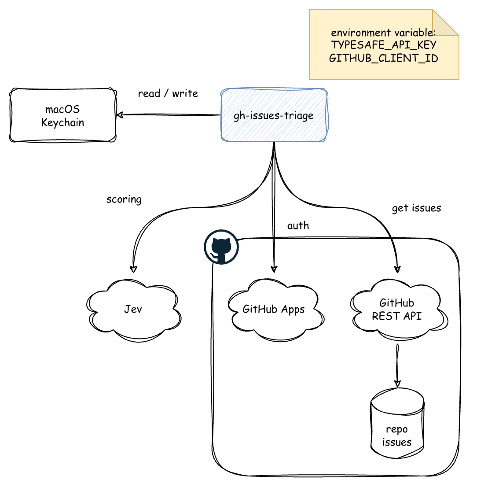

# GitHub Issues Triage

GitHub Issues の最新 100 件を取得し、Jev で重要度順に並べる CLI ツールです。

## Components



private repository を使う場合は、GitHub App を対象 repository に install し、
App の `Issues: Read` 権限を設定してください。

## Next Issue (JSON)

```shell
gh-issues-triage next owner/repo --format json

# リポジトリから実行する場合
cargo run -- next owner/repo --format json
```

最新の open Issue 最大100件 (pull request を除外) から、仕様整理に着手可能 (Ready が `Yes`) で重要度が最も高い1件を返します。
同点の場合は GitHub の取得順 (作成日時の新しい順) を維持します。
古い Issue を含む全件からの選択ではありません。

標準出力は、末尾に改行を付けた単一行の JSON です。

```json
{"repository":"owner/repo","number":42,"title":"保存処理の修正","body":"再現条件と完了条件。","score":3.6,"readiness":"Yes","branch_name":"fix/issue-42"}
```

`branch_name` は、選択した Issue の分類と番号から`<prefix>/issue-<number>` の命名規則で生成した候補1件です。
ブランチの存在や作成可否は確認しません。
JSON の項目は `repository`、`number`、`title`、`body`、`score`、`readiness`、`branch_name` です。

本文なしは空文字で返します。
重要度は丸めません。
該当する Issue がない場合は `null` を返し、終了コード `0` で終了します。
入力不正は終了コード `2`、認証・取得・判定・出力の失敗は終了コード `1` です。
失敗を `null` へ置き換えません。

認証方式と環境変数は一覧コマンドと共通です。
認証案内とエラーは標準エラー出力へ出します。
JSON はパイプやリダイレクトで取得できます。
端末幅やプロジェクトルートの設定は不要です。
ローカルブランチの有無は選択に影響せず、Issue やブランチは変更しません。

## Environment

- Rust
- `reqwest` crate
- `GITHUB_CLIENT_ID`: GitHub App client ID (token 更新と Device Flow 用)
- `TYPESAFE_API_KEY`: TypeSafe Jev API key (Issue triage 用)

認証には GitHub App の Device Flow を、Issue の取得には GitHub REST API を使います。

## How to Use

```shell
export GITHUB_CLIENT_ID='<GitHub App client ID>'
export TYPESAFE_API_KEY='<TypeSafe API key>'
gh-issues-triage owner/repo

# リポジトリから実行する場合
cargo run -- owner/repo

# AI エージェントのスキルから呼び出す時
gh-issues-triage next owner/repo --format json
```

認証情報がない場合は Device Flow の確認 URL とコードを表示します。
認証情報は macOS Keychain または Linux Secret Service に保存されます。
保存済み access token が失効した場合は refresh token で自動更新します。
refresh token がないか拒否された場合は Device Flow を開始します。
更新時に `client credentials were rejected` が返った場合も、理由を表示して Device Flow での再認証へ一度だけ進みます。
Keychain の項目を手動で削除する必要はありません。
表示されたコードで再認証すると、新しい認証情報を保存して Issue 取得を一度だけ再試行します。
再認証にも失敗した場合は、失敗した認証段階を示して終了します。
PAT と平文ファイルは使用しません。

repository 指定では、GitHub の open Issue を新しい順に最大 100 件取得し、pull request を除外します。
全 Issue を1回の TypeSafe Jev リクエストで重要度判定、ブランチ名の分類、着手可能度の判定を行い、端末幅に合わせた Unicode 対応テーブルで表示します。

一覧には、重要度、Ready、番号、Author、Assignees、日付、Issues を表示します。
Issues 列にはタイトルだけを表示し、行をクリックすると本文を開きます。
長い値は折り返し、マウスホイールで一覧全体をスクロールします。
マウスオーバーで対象行を仮選択します。

初期表示は重要度降順です。
重要度・番号・Author・日付の見出しをクリックすると並べ替えます。
同じ列の再クリックで方向を反転し、別の列は昇順から開始します。
同値は GitHub の取得順を維持し、Author の欠損は常に末尾です。
日付は作成日時を JST の `YYYY-MM-DD` で表示します。

一覧下部には、反転表示した `HELP`、`QUIT`、`SEARCH` を配置します。
隣接するボタンの間隔は半角空白1文字です。
ボタン左右の余白もクリックできます。

| 一覧の操作 | 動作 |
| --- | --- |
| `HELP` / `h` | ヘルプを開く |
| `QUIT` / `q` | アプリを終了する |
| `SEARCH` / `s` | 検索を開く |

検索ダイアログは、タイトル、空行、入力欄と Search、空行、Close の5行です。
上下の外枠を含めた高さは7行に固定します。
検索語を入力して `Search` をクリックします。
タイトルと本文を、空白区切りの AND 部分一致で検索します。
ASCII 英字の大文字と小文字は区別しません。
空文字または空白だけで検索すると、取得済み全件へ戻ります。
検索後もソート条件を維持します。追加の API 呼び出しは行いません。
`Close` で閉じた場合、入力中の検索語は破棄します。
Enter による検索確定は行いません。

本文ダイアログの横幅は端末幅の75% (端数切り捨て)、高さは端末高から4行を引いた値です。
長文はダイアログ内をホイールでスクロールできます。
`Close` と強調表示した `Create branch` は下部に固定します。
ダイアログ内の操作は、背後の一覧へ伝わりません。
`Close` で一覧へ戻ります。Ctrl+C はアプリを終了します。
一覧のキー操作は `h`、`q`、`s`、Ctrl+C です。
ダイアログはクリックとホイールで操作し、検索入力には文字入力・貼り付け・Backspace を使います。

ブランチ作成を使う場合、ローカルプロジェクト群の親ディレクトリを設定します。

```shell
gh-issues-triage config set-root /absolute/path/to/projects
```

対象ディレクトリは `<root>/repo` です。
本文ダイアログの `Create branch` をクリックすると、対象のローカル `main` から作成して切り替えます。
同名ブランチは上書きしません。失敗した場合は理由を表示します。
番号列の `🌿` はブランチあり、空欄はなし、`?` は確認不能です。
許可済みの refactor / fix / feat / chore / docs の `issue-<number>` を照合します。
リモートだけに存在するブランチと独自名は対象外です。
root 未設定などで確認できない場合も、理由を表示して一覧を継続します。

Ready は、重要度とは独立した仕様整理への着手可能度です。
具体的な動作や問題が分かれば `Yes`、機能の核心が不明なら `Needs information`、
仕様整理前の事実調査が不可欠なら `Needs investigation` とします。
実装への着手可否は判定しません。

詳細は [要求定義](docs/current/REQUIREMENTS.md)、[仕様](docs/current/SPECIFICATIONS.md)、[設計](docs/current/DESIGN.md)を参照してください。
